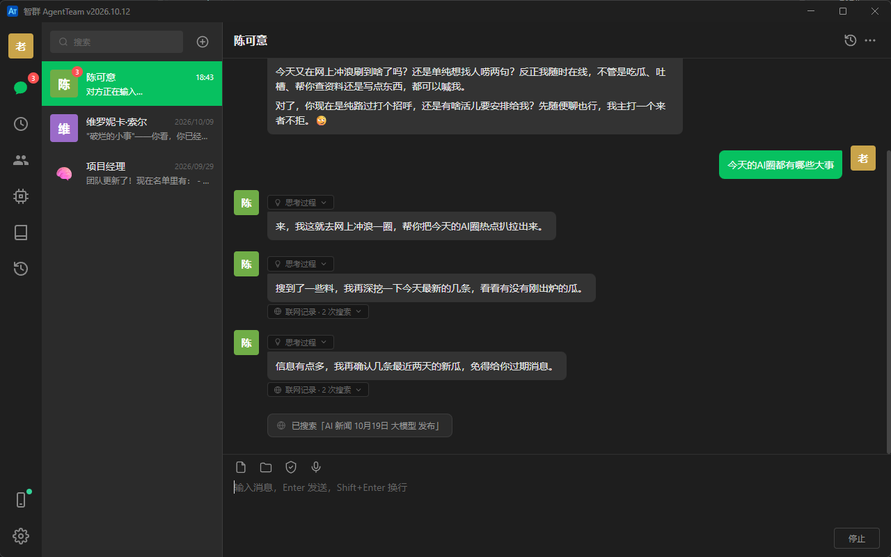

# 智群 AgentTeam · 桌面端（Electron + Vue）

私有化部署的桌面客户端：Electron 窗口内置 Vue 3 前端（`web/` 子目录，经 git subtree 并入），并自动拉起 [agent-team-server](https://github.com/guyu0327/agent-team-server) 后端（SQLite 单文件数据库），零外部依赖，开箱即用。



## 下载

最新版 Windows 安装包（内置 JRE，无需 Java）请到 [**Releases**](https://github.com/guyu0327/agent-team-desktop/releases) 页面下载。

## 相关仓库

- [agent-team-server](https://github.com/guyu0327/agent-team-server)：Spring Boot 后端（编排、会话、消息、SSE）
- [agent-team-web](https://github.com/guyu0327/agent-team-web)：Vue 3 前端（聊天应用布局）——已并入本仓库 `web/` 子目录，原仓库已归档

## 主要功能

### 智能体与模型

- **模型预设与文生图**
  - 支持 OpenAI 兼容对话与 DashScope / OpenAI Images / 硅基流动文生图协议
  - 对话预设可配置「推理强度」（low/medium/high；部分服务商默认不返回思考内容需显式开启，留空不发送参数）
  - 一键「测试连接」：真实发消息验证连通性，成功显示耗时与回文、失败展示原因（编辑态密钥留空自动用已存密钥，仅对话类预设支持）
  - 「批量应用到智能体」：列表右键菜单与详情页入口，多选智能体一键换绑（对话预设设为对话模型、文生图预设设为图像预设）
  - 新建智能体「一句话生成」：一句话描述想要的智能体，选一个已有对话模型自动填齐名称/头像/分组/简介/系统提示词/温度（可再修改，预设与技能仍手动选择，记住上次成功使用的生成模型）
  - 智能体头像可自定义文字与底色：编辑页点头像区域即可修改（底色可选自动配色），未自定义的按名称首字 + 哈希色展示；建群选的表情等旧头像值按表情渲染并铺哈希底色
- **智能体技能**
  - 「技能」页用 Markdown 编写技能文档（frontmatter 名称/描述 + 正文，可带辅助文件并一键打开所在文件夹），支持全局或逐智能体启用（编辑表单同步勾选），改技能即时生效无需重启
  - 对话中智能体可用 `install_skill` 自助安装（弹审批卡片确认，默认启用到自己）、`list_skills` 查看已装技能与「含你/不含你」绑定标注
  - 单聊/群聊成员、指挥、协作被委派成员三条链路全部生效
- **智能体长期记忆**
  - 对话中自行决定记住用户偏好与重要信息（`recordToMemory` 工具），SQLite 落库、跨会话生效，每轮自动注入系统提示
  - 智能体详情页「更多 → 记忆数据」可查看全部记忆并手动添加、编辑、删除、清空
- **回复字数范围**
  - 智能体编辑页可设置单条回复的字数范围（默认 0–120 字，软引导而非硬截断）：提示词要求简明扼要、说清即止，不再长篇大论；上限填 0 即不限制
  - 内容较多时智能体自动把一条回复拆成多条消息发送：流式按独立行 `---` 分隔符实时切分，聊天气泡逐条出现

### 对话与协作

- **单聊与群聊**
  - **指挥是会话角色，人人可拉群协作**：单聊里任何智能体需要协作时都会自动 `create_team` 拉群推进；群聊被动模式由「指挥」协调分工——建群固定为被动群并指定指挥（默认第一个勾选成员，弹层内可换），群菜单点成员下方「指挥」标签随时可换，未设置时全员依次回复；想要自由讨论进群后在群菜单切换（全员接龙，指挥角色休眠，切回被动自动恢复）；指挥拉群协作时，谁拉群谁默认是指挥。原智能体上的全局「指挥」身份已退役，不再区分
  - 群聊支持自由讨论、指挥协作、成员 @ 与置顶；回复进行中发送按钮变为「停止」可随时掐断（协作/讨论在顶部横幅终止）
  - **回复进行中发消息即「插话」**：消息立即落库上屏不再静默排队，当前成员把手头这条回复说完后剩余原计划作废、以插话为新触发继续——单聊同一智能体接着回，被动群聊按插话内容重新确定应答者（@谁谁回），自由讨论重新选人接龙；插话可连续进行，输入框在回复中提示「Enter 插话」
  - 单聊顶部横幅按状态显示「正在执行任务」，真正建群拉成员协作（create_team）那一刻才切「正在协调团队」；切页/重进后横幅按当前模式恢复
  - 点智能体消息的头像直达其详情页（自己与 QQ 外部成员除外）；群内右键点头像弹菜单 @ 对方；群标题「（N人）」可点击查看成员列表（指挥带徽标并排第一，普通群聊与协作任务群一致）
  - 会话列表的群聊头像按微信样式拼接：取群成员各自头像最多 9 个拼成宫格（2/3 人一行排开、4 人田字格、5 人起九宫格），已删除的成员不占格、成员不足 2 人回退群图标；QQ/微信通道群维持通道图标不拼接
  - 群聊菜单支持重置会话：旧群归档进历史，按原群名/成员/聊天模式一键重建新群
  - 编排协作的最终总结先在项目群完整公示（建过群时），再发回发起会话——单聊发起的协作群里不会只剩「如下——」的悬空引导；直接在群里发起的协作不重复公示
- **思考过程实时可见**
  - 推理模型（DeepSeek-R1 / GLM / Qwen 等）思考期间思考文本随生成逐字显示：单聊/指挥在思考条内，协作被委派成员在气泡内
  - 思考一结束立即在气泡上方出现「思考过程」折叠条（群聊有名字时位于名字与气泡之间）；思考全文随回复持久化（独立字段，不进气泡正文、不进对话上下文），可回看，导出聊天记录一并带出
  - 执行工具的间隙由工具气泡指示活动，思考条只在酝酿下一段（有实时思考文本）时带着内容回归；思考条与联网/浏览/工具提示条出现或增长时窗口自动贴底跟随
  - 普通模型无思考输出、显示不受影响
- **只说不做兜底**
  - AI 整轮没调用任何工具就宣称「已完成」时自动判定并追加纠正：先调工具核实实际状态、再真正完成、最后基于结果重新汇报
  - 每轮注入模型的历史末尾由系统附加【系统行动记录】（逐轮「说了什么→实际执行了什么」，零执行明确标注），AI 汇报前对照真实执行清单，不再把自己的口头自述当成既成事实
  - 上下文压缩摘要同步保留执行凭证
- **AI 向你提问**
  - 遇到做错代价高的歧义，AI 不再自行硬猜，用「提问」卡片把要拍板的问题集中一次问清——卡片插在输入框上方（不打断 AI 干活），每题最多 3 个候选选项 + 「其他」自由输入，答完一题弹下一题，全部答完 AI 无缝继续
  - 被委派成员的提问先由指挥代答，指挥也判断不了才转问你；定时任务后台轮与微信轮无人可答，不开放提问
- **上下文压缩**
  - 注入模型的总量（系统提示词等固定项 + 可压缩历史）达到预算 90% 即自动滚动摘要：后台执行不阻塞回复（本轮按预算截断历史先行，新摘要下轮生效）；图片首轮看完即降级为文字注记
  - 聊天页（输入区左下角）与任务页（页头）实时显示注入量细分「（固定 + 可压缩）/ 预算」与百分比，超 90% 变警示色；进入/刷新页面即重算，每轮回复结束亦自动刷新
  - 压缩期间百分比旁转圈提示并跟随压缩全程，失败转圈原地变红色叹号、点击查看具体原因，成功后转圈消失并当场刷新注入量
  - 设置页可调预算与开关（默认 50K 字符、开启，范围 20K-500K，单位 K）
- **协作限制**：设置页可配置编排协作与自由讨论的整体/单成员超时（默认 60/5 分钟）

### 工具与受控执行

- **联网能力**：自带 `web_search`（AnySearch 搜索）与 `fetch_webpage`（抓取网页正文）只读工具，单聊/群聊、编排协作全链路可用；零配置匿名即用，设置页可填 AnySearch API Key 提升额度；聊天页实时显示搜索/抓取动态，气泡下方「联网记录」折叠条可回看
- **AI 操作网页**
  - 经 Playwright 驱动系统已装的 Edge/Chrome（无需下载浏览器），12 个工具覆盖打开网页、点击、填输入框、选下拉框、滚动、截图查看画面、后退、刷新页面、查看与切换标签页、关闭——需要登录、点击、翻页、填表单或 JS 渲染的页面全能处理；页面卡住可刷新重试，点开新标签页自动跟过去
  - 页面正文里的内容图在结构快照里自动挂编号（含尺寸），AI 可按编号定点截图看图（图自动滚入视口再截），贴吧等图片社区不用再截全页找图
  - 自带反检测（隐藏自动化标记）与拟人节流（操作间随机间隔）；可开启「记住浏览器登录态」保持网站登录
  - 打开网页弹审批卡片（允许一次/本会话允许/拒绝/加入白名单）；设置页可维护域名白名单（含子域名，白名单域名所有会话免询问直接打开）；仅支持 http/https 且禁访本机/内网
  - 聊天页实时显示操作动态，气泡下方「浏览记录」折叠条带自动截图缩略图可回看（点击应用内查看大图，支持滚轮缩放与拖动平移）
  - 设置页可切围观模式（默认：弹出真实浏览器窗口看 AI 操作，避免误以为卡住）与无头模式（后台静默）
- **本机键鼠操控**
  - 智能体能直接操作这台电脑的键盘鼠标，覆盖浏览器到不了的桌面应用与系统弹窗；每次点击/按键/打字默认弹审批卡由你放行，也可在聊天页「工具授权」里为该会话开自动放行（开启前弹确认框明示三件事：会抢占你的键鼠焦点、打字走剪贴板粘贴会覆盖剪贴板、全屏截图能看到屏幕上的隐私内容）
  - 流程：先全屏截图（本地自动缩到视觉模型不再二次压缩的档位并标注分辨率）估算目标大致位置 → 小控件可再对那一片取原始分辨率的局部放大图（两套坐标自动换算）精确定位后点击，点击前移到位停顿片刻再按下 → 点击后回带落点周围 1:1 的局部放大核对图（点没点中一眼看清，不必再截全屏）
  - 截屏只读不弹卡；定时任务后台轮与微信轮不开放此能力
- **工具调用全量可见**：文件读写、终端命令、图片生成、技能、定时任务等工具调用实时显示「正在读取文件/正在执行命令…」提示条；气泡下方「工具调用」折叠条展开可看每次调用的目标详情（文件/目录完整路径、命令或名称摘要）与成败，文件与目录点击即用系统默认方式打开；记录随消息持久化、历史会话可回看；单聊与群聊协作（指挥与被委派成员）全覆盖
- **受控操作审批**
  - 写入/修改文件、执行终端命令、打开网页、键鼠操控前弹卡片询问（允许一次 / 本会话允许 / 拒绝，打开网页另有「加入白名单」快捷入口），「本会话允许」会批量放行同类待审批
  - 聊天页「会话授权」拆为「文件目录授权」与「工具授权」两个弹层：文件目录授权查看本会话开放的路径并可撤销；工具授权把 5 类受控操作（写入/修改文件、终端命令、打开网页、键鼠操控）一行一个开关——开＝本会话自动放行不再弹卡，关＝恢复弹卡询问，即时生效

### 外部渠道接入

- **微信接入**
  - 侧边栏手机图标扫码连接微信 iLink Bot，手机微信直接与智能体单聊
  - 消息实时落库到「微信ClawBot-xxxx」会话（小龙虾头像、按好友标识加后缀区分、桌面端只读）
  - 可随时切换处理智能体（插入系统标注，前任对话不归新处理者继承）与重置会话（旧会话归档到历史仅供查看、好友绑定无缝迁移）
  - 图片/文件/视频与语音转写均可处理；回复桌面流式可见、微信侧逐段推送（段落落定即发，协作总结不漏发）
- **QQ 机器人接入**
  - 侧边栏 QQ 图标入口，扫码即可绑定 QQ 开放平台的官方机器人（也可手动填 appId/AppSecret），QQ 好友私聊与群里 @ 机器人都能唤醒智能体
  - 桌面端对应会话以「QQ · 尾号」「QQ群 · 尾号」展示（企鹅头像）；群消息气泡上方显示发送者昵称与完整固定 ID（群主/管理员带徽标），机主的消息靠右归属自己
  - 安全边界：仅机主（扫码绑定人）的回合挂载工具，群内其他成员可对话但零工具（动不了这台电脑）；私聊/群聊可分别配置响应策略与名单
  - 智能体回复里的本地图片（限授权目录内）自动抽取上传发进 QQ；处理智能体、回复长度、回合超时等设置弹层即时保存生效

### 定时任务与历史

- **定时任务**
  - 侧边栏「定时任务」页管理任务会话：单次/每天/每周/固定间隔四种触发、错过补发、立即执行、暂停恢复与批量操作
  - 分「普通任务」（执行智能体独立完成）与「协作任务」（主导者拉成员建任务群协作，主导者不限身份任意智能体可当）；删除自动归档到历史会话、可一键恢复
  - 对话中智能体也能用 `schedule_task` 等工具为用户安排任务
- **任务后台自动放行**
  - 定时任务后台触发时无人响应审批卡片，按任务级「后台自动放行」配置执行：写入/修改文件默认放行、终端命令与打开网页默认不放行（均可开关），放行与拒绝均记入运行日志
  - 对话中手动执行不受影响，仍走人工审批；任务触发轮若只输出文字未实际执行，会自动追加纠正指令重试一轮
- **历史会话**
  - 删除/解散/重置/开始新会话的聊天自动归档到「历史会话」：按日期分组（分组可折叠，默认仅展开最新一组）、搜索、查看完整记录、继续聊天或彻底删除
  - 定时任务删除后整批归档于此（「定时任务」标签区分）；微信会话重置/删除后同样归档（仅供留档查看，不可恢复聊天）
- **导出聊天记录**
  - 单聊/群聊、定时任务、历史会话所有消息区域均可导出 Markdown 文件（会话信息、逐条消息与任务标注，附件仅标注路径），桌面端弹系统「另存为」
  - 列表右键菜单与右上角「⋯」菜单项保持一致，按「不影响数据 → 更新数据 → 删除数据」统一排序、删除类标红

### 界面与体验

- **多语言界面**：中文 / English 一键切换，全部界面文案接入 i18n
- **深浅色主题**：整站换肤，Windows 自绘标题条配色同步，重启记忆上次选择
- **新手引导**：首次启动自动弹出侧边栏聚光教学——欢迎卡讲清「配模型 → 建智能体 → 开聊天」三步上手路线，再依次聚光模型、通讯录、消息、定时任务、设置五个入口各配一句话说明；看完或中途关掉都算看过、不再自动弹出，设置 → 系统设置可随时重看；弹卡配色跟随深浅色主题
- **提问导航条与音乐律动**
  - 聊天页与历史会话页消息区右缘贴滚动条出现一列细刻度：「我发出的提问」每条一个刻度——点击平滑跳转到对应气泡、当前视口覆盖的刻度高亮
  - 悬停刻度弹出预览面板：面板内逐行预览附近的提问，鼠标沿刻度或在面板内上下移动，窗口内容都跟着像滚轮一样滚动定位（面板顶钉住不随内容跳动）；面板上滚轮同样翻动；刻度与面板之间的缝隙做了隐形桥接，鼠标慢速划过面板不消失
  - 设置 → 系统设置可开启音乐律动：聊天页刻度跟随电脑正在播放的声音像频谱柱一样跳动（Windows 系统回环采集，不经麦克风），提问少时上下补淡色辅助条凑成完整声谱，开关状态重启自动恢复
- **实时语音转写**：按住麦克风边说边出字（讯飞流式听写）

### 系统管理

- **运行日志**：设置页「数据管理」可查看后端关键日志，按类型/时间范围筛选
- **系统设置**：开机自启、深浅色主题、语言切换；工作区文件与授权目录可一键用系统默认方式打开

## 架构

```
agent-team-desktop（本项目，Electron 壳）
├── main.js               主进程：拉起/监控后端、启动等待页、单实例锁、本地访问令牌、双平台自绘标题栏（Windows 弱化标题条 / macOS 自绘红绿灯）、系统设置（主题/开机自启）
├── preload.js            向渲染进程注入 window.agentTeam（apiBase + token、原生文件选择、pathForFile 拖拽路径解析、剪贴板图片落盘、shell openPath）
├── boot.html             后端就绪前的启动等待页
├── web/                  Vue 3 前端源码（git subtree 并入，构建产物 web/dist 不入库）
└── resources/            后端与 JRE 产物（不入库，见下方「产物同步」）
    ├── server/           后端 fat jar（Spring Boot，默认 SQLite）
    └── jre/              jlink 裁剪的 JRE（win/、mac/ 按平台子目录，见 scripts/build-jre.cmd 与 build-jre.sh）
```

## 运行模式

| 命令 | 模式 | 行为 |
| --- | --- | --- |
| `npm start` | 桌面模式 | 立即显示启动等待页 → 自动分配空闲端口 → spawn `java -jar resources/server/agent-team-server.jar`（SQLite，数据落在用户目录）→ 健康检查 `/api/user` → 切换到内置前端；关窗弹出应用内确认框（最小化到托盘或退出） |
| `npm run dev` | 开发模式 | 仅加载 Vite 开发服务器 `http://localhost:5173`，不拉起后端；需先 `npm run dev:web`（起 web/ 前端开发服务器，代理到 8080），并自行启动 agent-team-server（裸跑，无令牌校验） |

### 数据与安全

- **数据目录**：桌面模式数据落在 `%APPDATA%/agent-team-desktop/`（`data/agent_team.db` + `workspace/` + `token` 访问令牌），与应用目录完全隔离
- **访问令牌**：主进程生成随机令牌传给后端（`app.security.token`）并注入前端，所有 API 请求自动携带，防止本机其他进程或浏览器网页读写本地 API
- **备份/恢复**：设置页「数据管理」支持导出备份（数据库快照 + `workspace/` 拷贝到所选文件夹）与从备份恢复（覆盖当前全部数据后应用自动重启），也可直接打开数据目录

## 桌面交互

### 托盘与关闭行为

- 应用常驻系统托盘：左键唤回主窗口，右键菜单（显示主窗口 / 退出）
- 点关闭（Windows 系统按钮、macOS 自绘红绿灯）弹出应用内样式的确认框：最小化到托盘（后端继续运行）或退出（结束后端）；勾选「不再询问」后按所选动作直接执行
- 设置页「系统设置 → 关闭窗口时」可随时改回（每次询问 / 最小化到托盘 / 直接退出，与确认框共用同一偏好）
- 外部 http(s) 链接（如模型控制台）统一交给系统默认浏览器打开

### 自绘标题栏

- 双平台均隐藏原生标题栏由应用自绘
- Windows：`titleBarOverlay` 保留系统绘制最小化/最大化/关闭按钮，图标+名称+版本号由前端绘成低亮度标题条（深浅色主题切换时系统按钮配色同步）
- macOS：`hiddenInset` 隐藏原生栏，前端在侧边栏自绘红绿灯（关闭/最小化/缩放），顶部搜索栏、标题栏等区域标记 `drag-region` 可拖动窗口

### 应用图标

- `build/icon.ico` / `build/icon.png` 为唯一来源：rcedit 写入 exe、开发态窗口/任务栏图标、托盘图标（打包态经 extraResources 复制到安装目录 resources）均取自这里
- Windows 托盘用 ico，macOS 托盘不支持 ico、改用同源 png（自动缩放到菜单栏尺寸）
- 更换图标只需替换 `build/icon.png` 后执行 `node scripts/build-icon.js` 重新生成全尺寸高清 ico（ico 已入库，无需手动维护）

## 产物同步

`resources/` 与 `web/dist` 为构建产物，不入库。克隆后先执行同步再 `npm start`：

```bash
# 1. 前端构建产物（本仓库 web/ 子目录，Vue 3 + Vite）
npm --prefix web install
npm run build:web           # → web/dist

# 2. 后端 jar
cd ../agent-team-server && ./mvnw -DskipTests package
cp target/agent-team-server-0.0.1-SNAPSHOT.jar ../agent-team-desktop/resources/server/agent-team-server.jar

# 3. 裁剪内置 JRE（在对应平台的机器上执行；jar 优先取源码仓库构建产物，回落本项目已同步的产物）
scripts\build-jre.cmd      # Windows → resources/jre/win
./scripts/build-jre.sh     # macOS   → resources/jre/mac

# 4. 应用图标（替换 build/icon.png 后执行，重新生成多尺寸高清 build/icon.ico）
node scripts/build-icon.js
```

## 打包分发

前置：完成「产物同步」与 JRE 裁剪，然后在目标平台上执行（Windows 包只能在 Windows 打，mac 包只能在 Mac 打）：

```bash
npm run dist         # Windows NSIS 安装包 → dist/agent-team-desktop-setup-x.y.z.exe
npm run dist:dir     # Windows 免安装解包版 → dist/win-unpacked/（打包态调试用）
npm run dist:mac     # macOS dmg → dist/（须在 Mac 上执行）
npm run dist:mac:dir # macOS 免安装 .app → dist/mac-*/（打包态调试用）
```

- 安装包内置 JRE，目标机器无需安装 Java；extraResources 按 `${os}` 宏只打包目标平台那份 JRE（`resources/jre/win|mac/`），运行时 `main.js` 按同名字目录查找
- macOS 默认只打包当前机器架构（Apple Silicon 或 Intel），双架构都要支持用 `npx electron-builder --mac --x64 --arm64`
- 双平台均未签名：Windows 首次运行有 SmartScreen 提示；macOS 首次打开需右键 →「打开」，或 `xattr -cr /Applications/AgentTeam.app` 绕过 Gatekeeper
- electron-builder 工具链已配置国内镜像（`.npmrc`）
- 运行时数据统一在 `%APPDATA%/agent-team-desktop/`，与安装位置无关；单实例锁保证重复启动只聚焦已有窗口

### 环境要求

- Node.js 20.19+（构建 web/ 前端与 Electron 壳时）
- 构建 JRE 与后端 jar 需要 JDK 21+；**运行打包产物不需要 Java**（已内置裁剪版 JRE）
- Electron 二进制已配置国内镜像（`.npmrc`），`npm install` 即可
