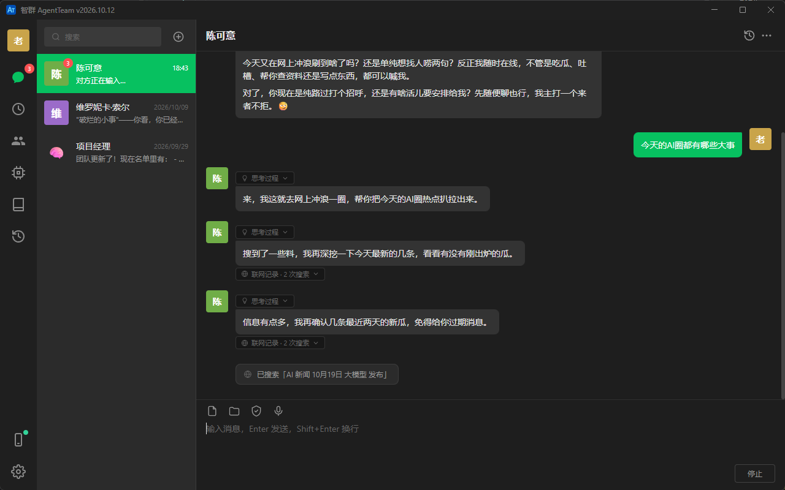

# 智群 AgentTeam · 桌面端（Electron + Vue）

私有化部署的桌面客户端：Electron 窗口内置 Vue 3 前端（`web/` 子目录，经 git subtree 并入），并自动拉起 [agent-team-server](https://github.com/guyu0327/agent-team-server) 后端（SQLite 单文件数据库），零外部依赖，开箱即用。

## 下载

最新版 Windows 安装包（内置 JRE，无需 Java）请到 [**Releases**](https://github.com/guyu0327/agent-team-desktop/releases) 页面下载。

## 相关仓库

- [agent-team-server](https://github.com/guyu0327/agent-team-server)：Spring Boot 后端（编排、会话、消息、SSE）
- [agent-team-web](https://github.com/guyu0327/agent-team-web)：Vue 3 前端（聊天应用布局）——已并入本仓库 `web/` 子目录，原仓库已归档

## 主要功能

- 多语言界面：中文 / English 一键切换，全部界面文案接入 i18n
- 深浅色主题：整站换肤，Windows 自绘标题条配色同步，重启记忆上次选择
- 单聊与群聊：群聊支持自由讨论、编排者协作、成员 @ 与置顶；群内左键点头像即可 @ 对方；群标题「（N人）」可点击查看成员列表（编排者徽标并排第一，普通群聊与协作任务群一致）；群聊菜单支持重置会话（旧群归档进历史，按原群名/成员/聊天模式一键重建新群）；回复进行中发送按钮变为「停止」可随时掐断（协作/讨论在顶部横幅终止）
- 思考过程实时可见：推理模型（DeepSeek-R1 / GLM / Qwen 等）思考期间思考文本随生成逐字显示在思考条内（单聊/编排者思考窗口）或成员气泡内（协作被委派成员）；思考一结束立即在气泡上方出现「思考过程」折叠条（群聊有名字时位于名字与气泡之间），思考全文随回复持久化（独立字段，不进气泡正文、不进对话上下文），可回看，导出聊天记录一并带出；执行工具的间隙由工具气泡指示活动，思考条只在酝酿下一段（有实时思考文本）时带着内容回归；思考条与联网/浏览/工具提示条出现或增长时窗口自动贴底跟随；普通模型无思考输出、显示不受影响
- 微信接入：侧边栏手机图标扫码连接微信 iLink Bot，手机微信直接与智能体单聊；消息实时落库到「微信ClawBot-xxxx」会话（小龙虾头像、按好友标识加后缀区分、桌面端只读），可随时切换处理智能体（插入系统标注，前任对话不归新处理者继承）与重置会话（旧会话归档到历史仅供查看、好友绑定无缝迁移），图片/文件/视频与语音转写均可处理；回复桌面流式可见、微信侧逐段推送（段落落定即发，协作总结不漏发）
- 定时任务：侧边栏「定时任务」页管理任务会话，支持单次/每天/每周/固定间隔四种触发、错过补发、立即执行、暂停恢复与批量操作；分「普通任务」（执行智能体独立完成）与「协作任务」（编排者拉成员建任务群协作），删除自动归档到历史会话、可一键恢复；对话中智能体也能用 schedule_task 等工具为用户安排任务
- 任务后台自动放行：定时任务后台触发时无人响应审批卡片，按任务级「后台自动放行」配置执行——写入/修改文件默认放行、终端命令与打开网页默认不放行（均可开关），放行与拒绝均记入运行日志；对话中手动执行不受影响，仍走人工审批；任务触发轮若只输出文字未实际执行，会自动追加纠正指令重试一轮
- 历史会话：删除/解散/重置/开始新会话的聊天自动归档到「历史会话」，可按日期分组（分组可折叠，默认仅展开最新一组）、搜索、查看完整记录、继续聊天或彻底删除；定时任务删除后整批归档于此，以「定时任务」标签区分；微信会话重置/删除后同样归档于此（仅供留档查看，不可恢复聊天）
- 导出聊天记录：单聊/群聊、定时任务、历史会话所有消息区域均可导出 Markdown 文件（会话信息、逐条消息与任务标注，附件仅标注路径），桌面端弹系统「另存为」；列表右键菜单与右上角「⋯」菜单项保持一致，按「不影响数据 → 更新数据 → 删除数据」统一排序、删除类标红
- 模型预设与文生图：支持 OpenAI 兼容对话与 DashScope / OpenAI Images / 硅基流动文生图协议；对话预设可配置「推理强度」（low/medium/high，部分服务商默认不返回思考内容需显式开启，留空不发送参数）；预设表单一键「测试连接」（真实发消息验证连通性，成功显示耗时与回文、失败展示原因，编辑态密钥留空自动用已存密钥，仅对话类预设支持）；预设「批量应用到智能体」（列表右键菜单与详情页入口，多选智能体一键换绑——对话预设设为对话模型、文生图预设设为图像预设）；新建智能体支持「一句话生成」——一句话描述想要的智能体，选一个已有对话模型自动填齐名称/头像/分组/简介/系统提示词/温度（可再修改，预设与技能仍手动选择，记住上次成功使用的生成模型）
- 联网能力：智能体自带 web_search（AnySearch 搜索）与 fetch_webpage（抓取网页正文）只读工具，单聊/群聊、编排协作全链路可用；零配置匿名即用，设置页可填 AnySearch API Key 提升额度，聊天页实时显示搜索/抓取动态、气泡下方「联网记录」折叠条可回看
- AI 操作网页：智能体经 Playwright 驱动系统已装的 Edge/Chrome（无需下载浏览器），12 个工具覆盖打开网页、点击、填输入框、选下拉框、滚动、截图查看画面、后退、刷新页面、查看与切换标签页、关闭，需要登录、点击、翻页、填表单或 JS 渲染的页面全能处理，页面卡住可刷新重试，点开新标签页自动跟过去；页面正文里的内容图在结构快照里自动挂编号（含尺寸），AI 可按编号定点截图看图（图自动滚入视口再截），贴吧等图片社区不用再截全页找图；自带反检测（隐藏自动化标记）与拟人节流（操作间随机间隔），可开启「记住浏览器登录态」保持网站登录；打开网页弹审批卡片（允许一次/本会话允许/拒绝/加入白名单），设置页可维护域名白名单（含子域名，白名单域名所有会话免询问直接打开），仅支持 http/https 且禁访本机/内网；聊天页实时显示操作动态，气泡下方「浏览记录」折叠条带自动截图缩略图可回看（点击应用内查看大图，支持滚轮缩放与拖动平移）；设置页可切围观模式（默认，弹出真实浏览器窗口看 AI 操作，避免误以为卡住）与无头模式（后台静默），定时任务可按任务配置后台放行
- 本机键鼠操控：智能体能直接操作这台电脑的键盘鼠标，覆盖浏览器到不了的桌面应用与系统弹窗——设置页新开关（默认关闭），开启时弹确认框明示三件事（会抢占你的键鼠焦点、打字走剪贴板粘贴会覆盖剪贴板、全屏截图能看到屏幕上的隐私内容），开启后新回合生效；流程为先全屏截图（本地自动缩到视觉模型不再二次压缩的档位并标注分辨率）在图上估算坐标再点击，点击坐标按「真实屏幕 ÷ 截图」比例自动换算并回带新截图核对；每次点击/按键/打字都弹审批卡由你放行（人不在即拒绝），截屏只读不弹卡；定时任务后台轮与微信轮不开放此能力
- 智能体技能：「技能」页用 Markdown 编写技能文档（frontmatter 名称/描述 + 正文，可带辅助文件并一键打开所在文件夹），支持全局或逐智能体启用（智能体编辑表单同步勾选）；智能体对话中可用 install_skill 自助安装（弹审批卡片确认，默认启用到自己）、list_skills 查看已装技能与「含你/不含你」绑定标注；单聊/群聊成员、编排者、协作被委派成员三条链路全部生效，改技能即时生效无需重启
- 工具调用全量可见：文件读写、终端命令、图片生成、技能、定时任务等工具调用实时显示「正在读取文件/正在执行命令…」提示条，气泡下方「工具调用」折叠条展开可看每次调用的目标详情（文件/目录完整路径、命令或名称摘要）与成败，文件与目录点击即用系统默认方式打开，记录随消息持久化、历史会话可回看；单聊与群聊协作（编排者与被委派成员）全覆盖
- 受控操作审批：写入/修改文件、执行终端命令、打开网页前弹卡片询问（允许一次 / 本会话允许 / 拒绝，打开网页另有「加入白名单」快捷入口），「本会话允许」会批量放行同类待审批
- AI 向你提问：遇到做错代价高的歧义，AI 不再自行硬猜，用「提问」卡片把要拍板的问题集中一次问清——卡片插在输入框上方（不打断 AI 干活），每题最多 3 个候选选项 + 「其他」自由输入，答完一题弹下一题，全部答完 AI 无缝继续；被委派成员的提问先由编排者代答，编排者也判断不了才转问你；定时任务后台轮与微信轮无人可答，不开放提问
- 实时语音转写：按住麦克风边说边出字（讯飞流式听写）
- 运行日志：设置页「数据管理」可查看后端关键日志，按类型/时间范围筛选
- 协作限制：设置页可配置编排协作与自由讨论的整体/单成员超时（默认 60/5 分钟）
- 上下文压缩：注入模型的历史超预算自动滚动摘要、图片首轮看完即降级为文字注记，设置页可调预算与开关（默认 6 万字符、开启）
- 智能体长期记忆：对话中自行决定记住用户偏好与重要信息（recordToMemory 工具），SQLite 落库、跨会话生效，每轮自动注入系统提示；智能体详情页「更多 → 记忆数据」可查看全部记忆并手动添加、编辑、删除、清空
- 系统设置：开机自启、深浅色主题、语言切换；工作区文件与授权目录可一键用系统默认方式打开

## 架构

```
agent-team-desktop（本项目，Electron 壳）
├── main.js               主进程：拉起/监控后端、启动等待页、单实例锁、本地访问令牌、双平台自绘标题栏（Windows 弱化标题条 / macOS 自绘红绿灯）、系统设置（主题/开机自启）
├── preload.js            向渲染进程注入 window.agentTeam（apiBase + token、原生文件选择、pathForFile 拖拽路径解析、剪贴板图片落盘、shell openPath）
├── boot.html             后端就绪前的启动等待页
├── web/                  Vue 3 前端源码（git subtree 并入，构建产物 web/dist 不入库）
└── resources/            后端与 JRE 产物（不入库，见下方「产物同步」）
    ├── server/           后端 fat jar（Spring Boot，默认 SQLite）
    └── jre/              jlink 裁剪的 JRE（win/、mac/ 按平台子目录，见 scripts/build-jre.cmd 与 build-jre.sh）
```

## 运行模式

| 命令 | 模式 | 行为 |
| --- | --- | --- |
| `npm start` | 桌面模式 | 立即显示启动等待页 → 自动分配空闲端口 → spawn `java -jar resources/server/agent-team-server.jar`（SQLite，数据落在用户目录）→ 健康检查 `/api/user` → 切换到内置前端；关窗弹出应用内确认框（最小化到托盘或退出） |
| `npm run dev` | 开发模式 | 仅加载 Vite 开发服务器 `http://localhost:5173`，不拉起后端；需先 `npm run dev:web`（起 web/ 前端开发服务器，代理到 8080），并自行启动 agent-team-server（裸跑，无令牌校验） |

桌面模式下数据目录为 `%APPDATA%/agent-team-desktop/`（`data/agent_team.db` + `workspace/` + `token` 访问令牌），与应用目录完全隔离。

安全机制：主进程生成随机令牌传给后端（`app.security.token`）并注入前端，所有 API 请求自动携带，防止本机其他进程或浏览器网页读写本地 API。

数据备份/恢复：设置页「数据管理」支持导出备份（数据库快照 + `workspace/` 拷贝到所选文件夹）与从备份恢复（覆盖当前全部数据后应用自动重启），也可直接打开数据目录。

托盘与关闭行为：应用常驻系统托盘（左键唤回主窗口，右键菜单：显示主窗口 / 退出）。点关闭（Windows 系统按钮、macOS 自绘红绿灯）弹出应用内样式的确认框——最小化到托盘（后端继续运行）或退出（结束后端），勾选「不再询问」后按所选动作直接执行；设置页「系统设置 → 关闭窗口时」可随时改回（每次询问 / 最小化到托盘 / 直接退出，与确认框共用同一偏好）。外部 http(s) 链接（如模型控制台）统一交给系统默认浏览器打开。

自绘标题栏：双平台均隐藏原生标题栏由应用自绘——Windows 用 `titleBarOverlay` 保留系统绘制最小化/最大化/关闭按钮，图标+名称+版本号由前端绘成低亮度标题条（深浅色主题切换时系统按钮配色同步）；macOS 用 `hiddenInset` 隐藏原生栏，前端在侧边栏自绘红绿灯（关闭/最小化/缩放），顶部搜索栏、标题栏等区域标记 `drag-region` 可拖动窗口。

应用图标：`build/icon.ico` / `build/icon.png` 为唯一来源——rcedit 写入 exe、开发态窗口/任务栏图标、托盘图标（打包态经 extraResources 复制到安装目录 resources）均取自这里；Windows 托盘用 ico，macOS 托盘不支持 ico 改用同源 png（自动缩放到菜单栏尺寸）。更换图标只需替换 `build/icon.png` 后执行 `node scripts/build-icon.js` 重新生成全尺寸高清 ico（ico 已入库，无需手动维护）。

## 产物同步

`resources/` 与 `web/dist` 为构建产物，不入库。克隆后先执行同步再 `npm start`：

```bash
# 1. 前端构建产物（本仓库 web/ 子目录，Vue 3 + Vite）
npm --prefix web install
npm run build:web           # → web/dist

# 2. 后端 jar
cd ../agent-team-server && ./mvnw -DskipTests package
cp target/agent-team-server-0.0.1-SNAPSHOT.jar ../agent-team-desktop/resources/server/agent-team-server.jar

# 3. 裁剪内置 JRE（在对应平台的机器上执行；jar 优先取源码仓库构建产物，回落本项目已同步的产物）
scripts\build-jre.cmd      # Windows → resources/jre/win
./scripts/build-jre.sh     # macOS   → resources/jre/mac

# 4. 应用图标（替换 build/icon.png 后执行，重新生成多尺寸高清 build/icon.ico）
node scripts/build-icon.js
```

## 打包分发

前置：完成「产物同步」与 JRE 裁剪，然后在目标平台上执行（Windows 包只能在 Windows 打，mac 包只能在 Mac 打）：

```bash
npm run dist         # Windows NSIS 安装包 → dist/agent-team-desktop-setup-x.y.z.exe
npm run dist:dir     # Windows 免安装解包版 → dist/win-unpacked/（打包态调试用）
npm run dist:mac     # macOS dmg → dist/（须在 Mac 上执行）
npm run dist:mac:dir # macOS 免安装 .app → dist/mac-*/（打包态调试用）
```

- 安装包内置 JRE，目标机器无需安装 Java；extraResources 按 `${os}` 宏只打包目标平台那份 JRE（`resources/jre/win|mac/`），运行时 `main.js` 按同名字目录查找
- macOS 默认只打包当前机器架构（Apple Silicon 或 Intel），双架构都要支持用 `npx electron-builder --mac --x64 --arm64`
- 双平台均未签名：Windows 首次运行有 SmartScreen 提示；macOS 首次打开需右键 →「打开」，或 `xattr -cr /Applications/AgentTeam.app` 绕过 Gatekeeper
- electron-builder 工具链已配置国内镜像（`.npmrc`）
- 运行时数据统一在 `%APPDATA%/agent-team-desktop/`，与安装位置无关；单实例锁保证重复启动只聚焦已有窗口

### 环境要求

- Node.js 20.19+（构建 web/ 前端与 Electron 壳时）
- 构建 JRE 与后端 jar 需要 JDK 21+；**运行打包产物不需要 Java**（已内置裁剪版 JRE）
- Electron 二进制已配置国内镜像（`.npmrc`），`npm install` 即可
